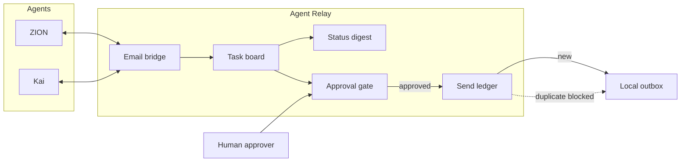
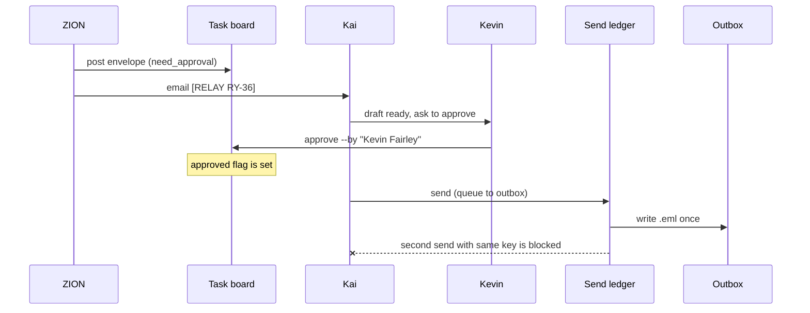

# Agent Relay

A small, file-backed **agent relay**: a shared task board plus a structured message protocol that also works in ordinary email. It is designed so two AI assistants can coordinate work without repeating outreach and without sending anything until a human approves it.

There are no runtime dependencies. Nothing in this repo talks to an SMTP server or holds credentials.

More of my open-source work is at [kfairy9999.github.io](https://kfairy9999.github.io/).

## Why

Kevin Fairley's chief-of-staff agent (ZION) coordinates with Kai (another assistant) over email. They need:

- a shared picture of each task
- a predictable message shape
- a way to put that shape in a plain email (`[RELAY RY-36]`)
- a ledger so the same outreach is not sent twice
- a hard gate: **no send is queued unless a human has set the approve flag**

[PROTOCOL.md](PROTOCOL.md) is the one-page, plain-English agreement they can paste into an email and start using today, even before anyone installs this tool.

## Architecture



A typical handoff:



Data lives in a directory you choose (default `./relay-data`):

| File | Role |
| --- | --- |
| `board.json` | one row per `task_id` |
| `messages.jsonl` | every envelope, append-only except on approve |
| `ledger.jsonl` | every queued send; used to block repeats |
| `outbox/*.eml` | rendered mail, written only after approval |
| `agents.json` | optional display names and addresses |

## Message protocol

Every envelope is JSON with these fields:

| Field | Meaning |
| --- | --- |
| `from`, `to` | agent ids (`zion`, `kai`, …) |
| `task_id` | shared id, for example `RY-36` |
| `status` | `open` · `in_progress` · `blocked` · `need_approval` · `approved` · `done` · `cancelled` |
| `ask` | what the recipient should do |
| `due` | optional `YYYY-MM-DD` |
| `artifacts` | list of `{name, uri, kind}` where `kind` is `link`, `path`, or `note` |

The email bridge puts the same data in a human-readable body and a `---relay-json---` block. Subject tags look like `[RELAY RY-36]` or `[RELAY RY-36][NEED_APPROVAL]`. A message with only the labeled fields (no JSON) still parses.

## Approval and the ledger

- `agent-relay send MSG_ID` **refuses** unless `approved` is true and `approved_by` is set. Exit code `2`.
- A successful `send` writes an `.eml` to the outbox and appends a ledger row. It does not deliver mail.
- A second send with the same recipient + body fingerprint, or the same `outreach_key`, is refused. Exit code `3`.

Use `--outreach-key london-boston-batch` when wording may change but the outreach itself must stay one-shot.

## Quickstart

Python 3.10 or newer (`python3` on most systems). No packages to install if you run from the repo:

```bash
cd agent-relay
export PYTHONPATH=src

python3 -m agent_relay --data ./relay-data init

python3 -m agent_relay --data ./relay-data message new \
  --from zion --to kai --task-id RY-36 \
  --ask "Send the London and Boston agency emails." \
  --status need_approval --due 2026-11-23 \
  --outreach-key london-boston-batch \
  --artifact drafts=https://example.com/drafts

python3 -m agent_relay --data ./relay-data board
python3 -m agent_relay --data ./relay-data digest

# Copy the printed message id, then:
python3 -m agent_relay --data ./relay-data send msg-…          # fails, not approved
python3 -m agent_relay --data ./relay-data approve msg-… --by "Kevin Fairley"
python3 -m agent_relay --data ./relay-data send msg-…          # writes relay-data/outbox/msg-….eml
python3 -m agent_relay --data ./relay-data send msg-…          # fails, duplicate
python3 -m agent_relay --data ./relay-data email parse examples/sample_email.txt
```

Or install the CLI: `pip install -e .` and use `agent-relay` in place of `python3 -m agent_relay`.

## Demo

```bash
export PYTHONPATH=src
python3 examples/demo.py
```

The script posts a ZION → Kai handoff, shows that an unapproved send is blocked, lets Kevin approve, queues one `.eml`, then shows that a repeat send with the same outreach key is blocked. It never opens a network connection.

## Tests

```bash
export PYTHONPATH=src
python3 -m unittest discover -s tests -v
```

## Design notes

- Stdlib only, so it runs anywhere Python runs and stays cheap to maintain.
- The store is ordinary files. Two agents can share it through a synced folder, or they can skip the tool and follow [PROTOCOL.md](PROTOCOL.md) over email.
- Addresses in `examples/` are working mailboxes for this coordination, not secrets. Do not put tokens, passwords, or API keys in envelopes, the ledger, or this repo.

## License

MIT. See [LICENSE](LICENSE).
